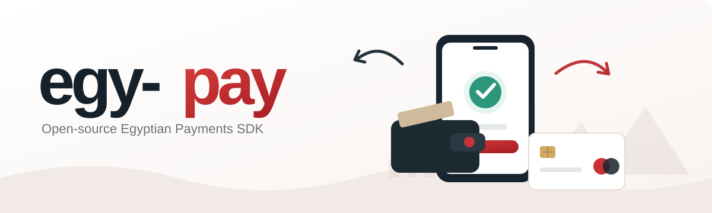

<p align="center">
  
</p>

<h1 align="center">egy-pay</h1>

<p align="center">
  <strong>Payment workflows built for Egypt. Designed for developers.</strong>
</p>

<p align="center">
  A headless, framework-agnostic TypeScript SDK for managing local payment workflows
  with Vodafone Cash, InstaPay, and future payment-provider integrations.
</p>

<p align="center">
  <a href="#why-egy-pay">Why egy-pay?</a> ·
  <a href="#how-it-works">How it works</a> ·
  <a href="#architecture">Architecture</a> ·
  <a href="#roadmap">Roadmap</a>
</p>

> **Project status: planning / early development.** The SDK is **not yet released on npm**. Interfaces and examples below describe the proposed developer experience, not working or published APIs.

## Why egy-pay?

Businesses in Egypt frequently accept transfers through **Vodafone Cash** and **InstaPay**, but developers still have to implement the surrounding application logic themselves: tracking payment attempts, collecting transfer claims, reviewing evidence, reconciling transactions, and preventing duplicate confirmations.

**egy-pay** aims to make that logic reusable. It is **not** a hosted gateway, a bank integration, or merely a checkout UI.

## What it will do

| Capability | Planned behavior |
| --- | --- |
| **Payment intents** | Create and track requests tied to an application's orders, using integer amounts in piasters |
| **Manual payment instructions** | Expose configured recipient details for Vodafone Cash or InstaPay |
| **Payment claims** | Record customer-submitted references and evidence metadata without treating them as proof of payment |
| **Payment lifecycle** | Enforce explicit state transitions, expiration policies, and auditable changes |
| **Verification** | Let an authorized reviewer or authenticated provider adapter confirm a transaction |
| **Reconciliation** | Match records from trusted transaction sources against payment intents; flag ambiguous matches |
| **Idempotency** | Guard against retries and repeated processing using atomic persistence |
| **Payment events** | Notify the host application of confirmed state changes without double-processing orders |

### Supported methods (initial focus)

- **Vodafone Cash** — manual transfer workflow.
- **InstaPay** — manual transfer workflow using merchant-provided payment instructions.

Official provider integrations may be added as independent adapters when suitable authorized APIs are available. Neither method currently implies automatic transfer initiation or verification in this project.

## How it works

```text
Customer checks out
        │
        ▼
Your backend creates a payment intent
        │
        ▼
egy-pay returns configured payment instructions
        │
        ▼
Customer transfers using their wallet / banking app
        │
        ▼
Customer submits a transaction claim
        │
        ▼
Claim is recorded as UNDER_REVIEW (not PAID)
        │
        ▼
Authorized review or verified provider transaction
        │
        ├── not verified ──► REVIEW / REJECT
        │
        └── verified ──────► PAID ──► Order fulfillment
```

**Important:** A screenshot, transfer reference, or customer-submitted confirmation **cannot prove that funds arrived**. Only an authorized review of a trusted source or a verified provider callback can approve a payment. The merchant's backend remains responsible for authentication, authorization, order ownership, and calculating the payable amount.

## Developer experience (proposed)

The following is **illustrative pseudocode**. It is not yet installable or implemented:

```ts
// Proposed @egy-pay/core API — subject to change.
import { createEgyPay } from "@egy-pay/core";

const payments = createEgyPay({ storage });

const intent = await payments.createIntent({
  orderId: "ORD-123",
  amountMinor: 50000, // EGP 500.00
  currency: "EGP",
  method: "vodafone_cash",
  idempotencyKey: "ORD-123:attempt-1",
});

// The customer claims to have transferred funds.
await payments.submitClaim({
  paymentId: intent.id,
  transactionRef: "EXAMPLE-REF",
});

// Later: a separate, authorized server-side verification flow
// may confirm the payment using trusted evidence.
```

The intent amount and recipient settings must come from **trusted server-side configuration**, not user-controlled checkout fields.

## Architecture

The intended architecture is **headless** and **framework-agnostic**:

```text
Node.js / Next.js Route Handlers / tRPC / Express / Fastify / NestJS
                              │
                              ▼
                       @egy-pay/core
                  ┌───────────┼───────────┐
                  │           │           │
           Payment logic  Verification  Reconciliation
                  │           │           │
                  └───────────┼───────────┘
                              ▼
                   Transactional storage
                       (adapter)
```

The core should depend on **domain interfaces**, not on a particular web framework or ORM. Authorization belongs at the application boundary, while payment transitions and evidence requirements must also be enforced by the SDK.

### Proposed packages

| Package | Role | Status |
| --- | --- | --- |
| `@egy-pay/core` | Payment lifecycle, validation, claims, reconciliation | Planned |
| `@egy-pay/storage-postgres` | Transactional PostgreSQL persistence | Planned |
| `@egy-pay/react` | Optional payment instructions and claim UI | Future |
| `@egy-pay/paymob` | Authorized provider adapter, if supported | Future |

Package names are proposals and are **not a claim of npm availability or ownership**.

## Design principles

- **Server-first:** Financial operations run in trusted server-side code, not browser-side SDK methods.
- **Framework-independent:** Works with different Node.js web frameworks and API styles, including REST and tRPC.
- **Correct money representation:** Store EGP amounts in integer piasters, not floating-point pounds.
- **Concurrency-safe:** State transitions, transaction-reference uniqueness, idempotency keys, and event delivery require atomic database behavior.
- **Auditable:** Preserve verification provenance and a history of payment changes.
- **Minimal infrastructure:** No hosted egy-pay service, paid API dependency, or LLM required for the manual-flow core.
- **Privacy-aware:** Avoid logging transaction references, wallet numbers, and personal details in plaintext.

## What egy-pay does *not* do

- Send or receive money directly.
- Access consumer wallet or bank balances.
- Read a customer's SMS messages.
- Verify transfers from screenshots or untrusted transaction IDs.
- Automatically confirm InstaPay or Vodafone Cash transfers without an authorized, trusted data source.
- Replace a licensed payment gateway, financial institution, or merchant compliance obligations.

## Roadmap

- [ ] **v0.1** — Typed domain models, payment-intent lifecycle, claim submission, explicit verification decisions, and a transactional storage contract.
- [ ] **v0.2** — PostgreSQL adapter, idempotent payment events, reconciliation primitives, and end-to-end integration tests.
- [ ] **v0.3** — Optional React UI, import tooling, and additional documentation/examples.
- [ ] **Later** — Authorized payment-provider adapters and webhook signature verification where integration access exists.

## Contributing

The project is at an early stage. Use [GitHub Issues](https://github.com/ibrahim8ismael/egy-pay/issues) to propose an Egyptian payments use case, discuss the public TypeScript API, or report a design concern before opening a pull request.

## License

MIT. Licensed under the [MIT License](./LICENSE).

---

<p align="center"><strong>Built for Egyptian developers. Open for everyone.</strong></p>
